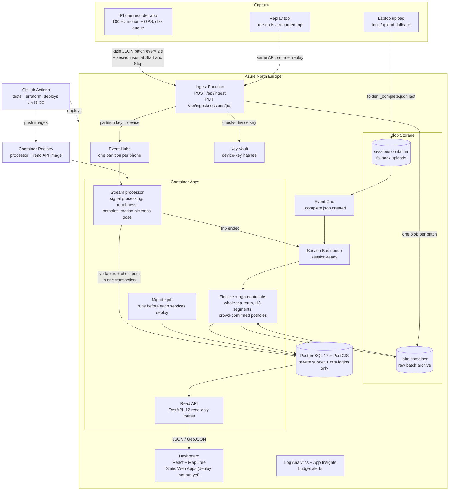

# DataInfrastructure_Chuds: Road & Ride

Codelap Hackathon 2026 (Porsche Engineering, "Data-Driven Infrastructure Engineering"). Road quality and motion sickness measured with phone sensors in cars, buses and trams, sent to Azure live while driving, processed, and shown on a map dashboard.



Everything in the diagram is built. The laptop upload is the fallback for a trip that never streamed; the Event Grid → Service Bus wiring for it is deployed.

- Plans and decision log: [decisions/](decisions/README.md)
- iPhone recorder spec: [decisions/01-initial-plan.md](decisions/01-initial-plan.md)
- Azure architecture and the reasons behind it: [decisions/02-infrastructure-plan.md](decisions/02-infrastructure-plan.md)

## Status (2026-11-21)

### Done and running on Azure

| Part | Where | What it does today |
|---|---|---|
| **Infrastructure (Terraform)** | [`infra/`](infra/README.md) | The whole stack in North Europe from one Terraform config: VNet, PostgreSQL 17 + PostGIS (private, Entra login only), Event Hubs, Service Bus, Blob Storage, Key Vault, Container Registry, Container Apps, the ingest Function app, Static Web App, Log Analytics, budget alerts. GitHub OIDC identities, no stored Azure secrets. |
| **Ingest function** | [`services/ingest/`](services/ingest/README.md) | `POST /api/ingest` and `PUT /api/ingest/sessions/{id}`. Checks the device key, then validates gzip, size, JSON and schema in the same order as the app's mock server. Sends each batch to Event Hubs (one partition per phone) and the raw archive. |
| **Database** | [`db/migrations/`](db/migrations) | Sessions, devices, batches, GPS track, labels, live state, stream checkpoints, chart series, events, pipeline state, segment passes and the aggregated map. A migrate job applies them on every deploy and creates the read/write database roles for the services. |
| **Stream processor** | [`services/processor/`](services/processor/README.md) | Reads Event Hubs and writes the tables above. Drops duplicates, keeps late batches off the live map, and marks a trip as ended once its Stop message and all batches are in. Each write commits together with the stream checkpoint, so a restart loses and repeats nothing. |
| **Signal processing** | [`services/processor/roadride/dsp.py`](services/processor/README.md#signal-processing-roadridedsppy) | Per batch: vertical acceleration, road roughness (1–30 Hz), the ISO 2631-1 Wf motion-sickness dose (MSDV), pothole detection above 15 km/h, speed bumps from the double peak in pitch rate (front axle, then rear axle), and a 5 Hz chart series. It gives the same results fed batch by batch or as one whole trip. |
| **Finalize + aggregate jobs** | [`services/processor/`](services/processor/README.md#finalize-job-roadridefinalizepy) | When a trip ends (Stop + all batches, or 15 minutes of silence) the processor queues it; the finalize job reruns the whole trip from the raw archive (or a laptop upload, which wins), writes it as Parquet to `lake`, replaces the live results, scores its data quality (phone handled, gravity drift, gyro vs. GPS, GPS accuracy) and its detections against the manual taps, splits it into H3 road-segment passes and rebuilds the shared map: vehicle-normalized roughness, crowd-confirmed potholes, sickness by seat. |
| **Read API** | [`services/read-api/`](services/read-api/README.md) | All 12 routes of [`dashboard/API.md`](dashboard/API.md), read-only. Tracks are served whole, with no start/end trim (D40). |
| **Replay tool** | [`tools/replay/`](tools/replay/README.md) | Re-sends a recorded trip through the live path as a new trip (`source=replay`, never aggregated), at real speed or faster. Used for the end-to-end test without driving, for the demo, and for tuning the pothole threshold on real data. |
| **Upload tool** | [`tools/upload/`](tools/upload/README.md) | The fallback for a trip that never streamed: copies a session folder from a laptop to Blob Storage (no raw audio, no rater name) and writes a manifest last. The finalize job checks it, rebuilds the trip's batches from the CSVs and processes it like a streamed trip; an upload replaces whatever part of the trip did stream. |
| **CI/CD** | [`.github/workflows/`](.github/workflows) | Tests on every PR and every push to `staging` or `main`, including integration tests against a real PostGIS. Only `main` deploys: merges there run the same tests again and, only if they pass, ship the ingest function (then check that it answers) and the processor + read API (migrations first, then a check that every API route answers). |

### Done, waiting on one step

| Part | What's missing |
|---|---|
| **Dashboard** ([`dashboard/`](dashboard/README.md)) | Built, and the deploy workflow exists, but **deploy-dashboard hasn't been run yet**. Until it is, the website runs on its built-in mock data. Run it from the Actions tab: it points the site at the real read API and uploads it. |
| **iPhone app** ([`src/mobile-ios/`](src/mobile-ios/README.md)) | Built and tested by the team. The phone needs the ingest URL and a device key in its upload settings. The URL is `ingest_base_url` from `./infra/tf.ps1 output` (`https://<function host>`, no path; the app adds `/api/ingest`); `pwsh infra/scripts/add-device-key.ps1 -DeviceId <name>` creates the key. |
| **End-to-end test** | Every piece is tested on its own, and the deploys check the Azure logins. **No real batch has gone from a phone to the dashboard yet.** The first test is either a real drive or a [replay](tools/replay/README.md) of a recorded session folder. If the Live page stays empty, check the ingest function's logs first. |
| **Monitoring workbook** ([`infra/`](infra/README.md#monitoring-workbook)) | Defined in Terraform, **not applied yet**: `.\tf.ps1 apply` creates it. One page for the live path: ingest requests by status, Event Hubs traffic, processor lag and events per minute, finalize runs and dead letters, the queue, PostgreSQL load and the read API. |

### Not built yet

In the plan's build order:

1. **Alert rules** for errors and processor lag (plan §5). The email action group exists.

## Branches

```
feature branch ──PR──▶ staging ──PR (release)──▶ main ──▶ deploys to Azure
```

- **`staging`** is the default branch: open every PR against it. Each push runs all the tests; nothing is deployed, so it's safe to merge into at any time.
- **`main`** is production. A merge into it deploys, so promote with a `staging` → `main` PR only when staging is green, with the team's OK and outside a trip-collection window.
- The deploy workflows refuse to run from any branch but `main`, even when started by hand.
- There is no staging copy of the Azure stack: the first real check of a change on Azure is after it reaches `main`.

## Repository

```
decisions/            plans, decision log, research notes
infra/                Terraform: bootstrap (state, OIDC) + main stack + modules; tf.ps1 runs it
services/ingest/      Azure Function (Python): the phone's front door
services/processor/   stream processor, signal processing, migrate/finalize/aggregate jobs (one image)
services/read-api/    FastAPI read API for the dashboard
db/migrations/        SQL migrations
dashboard/            React + MapLibre + uPlot web app (mock backend built in)
src/mobile-ios/       the iPhone recorder (Swift)
tools/replay/         re-sends a recorded trip through the live path (Python, stdlib only)
tools/upload/         laptop fallback: uploads a session folder for the finalize job (Python, stdlib only)
.github/workflows/    CI and deploys
docker-compose.yml    local PostGIS for development
```

## Deploying

| What | How |
|---|---|
| Infrastructure | `cd infra; ./tf.ps1 apply` in `pwsh` on macOS (`brew install --cask powershell`) or in Windows PowerShell (settings in `infra/.env`, see [`infra/README.md`](infra/README.md)) |
| Ingest function | automatic on merge to `main` (`deploy-ingest`), or `services/ingest/deploy.ps1` |
| Processor, migrations, read API | automatic on merge to `main` (`deploy-services`) |
| Dashboard | manual: Actions → **deploy-dashboard** → Run workflow |
| A phone's device key | `pwsh infra/scripts/add-device-key.ps1 -DeviceId <name>` (prints the key once) |
| A trip that never streamed | `az login`, then `python3 tools/upload/upload.py <session folder or .zip> --account <storage_account_name>` ([tools/upload](tools/upload/README.md)) |
| A replay of a recorded trip | `python3 tools/replay/replay.py <session folder or .zip>` with `REPLAY_API_URL` (= `ingest_base_url`) and `REPLAY_DEVICE_KEY` set: `export` in bash/zsh, `$env:` in PowerShell ([tools/replay](tools/replay/README.md)) |
