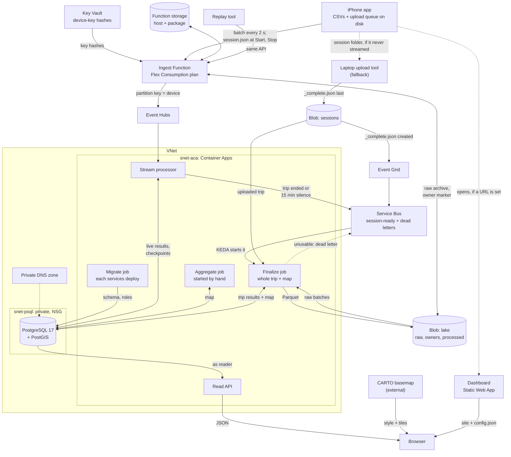
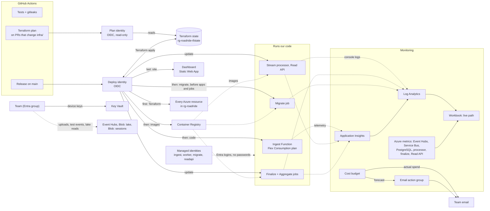

# DataInfrastructure_Chuds: Bumpy

Codelap Hackathon 2026 (Porsche Engineering, "Data-Driven Infrastructure Engineering"). Road quality and motion sickness measured with phone sensors in cars, buses and trams, sent to Azure live while driving, processed, and shown on a map dashboard.

**Data path:** from the phone to the map.



**Platform:** how it is deployed, logged in and watched.



All Azure resources are in `rg-roadride`, except the Terraform state and the two GitHub identities (`rg-roadride-tfstate`). Solid arrows are the main flow; dotted ones are fallbacks and supporting links.

Everything in the diagrams is built and deployed. The laptop upload is the fallback for a trip that never streamed; its Event Grid → Service Bus wiring is part of the Terraform stack.

- Plans and decision log: [decisions/](decisions/README.md)
- iPhone recorder spec: [decisions/01-initial-plan.md](decisions/01-initial-plan.md)
- Azure architecture and the reasons behind it: [decisions/02-infrastructure-plan.md](decisions/02-infrastructure-plan.md)

## Status (2026-11-22)

### Done and running on Azure

| Part | Where | What it does today |
|---|---|---|
| **Infrastructure (Terraform)** | [`infra/`](infra/README.md) | The whole stack from one Terraform config, in North Europe (the Static Web App in East US 2): VNet, PostgreSQL 17 + PostGIS (private, Entra login only), Event Hubs, Service Bus, Blob Storage, Key Vault, Container Registry, Container Apps, the ingest Function app, Static Web App, Log Analytics, Application Insights, budget alerts. GitHub OIDC identities, no stored Azure secrets. A release applies it when it changes (`terraform-apply`). |
| **Ingest function** | [`services/ingest/`](services/ingest/README.md) | `POST /api/ingest` and `PUT /api/ingest/sessions/{id}`. Checks the device key, then validates gzip, size, JSON and schema in the same order as the app's mock server. Then checks that the key may send as the body's device and that the session belongs to that device (403, D53). Sends each batch to Event Hubs (one partition per phone) and the raw archive. |
| **Database** | [`db/migrations/`](db/migrations) | Sessions, devices, batches, GPS track, labels, live state, stream checkpoints, chart series, events, pipeline state, segment passes and the aggregated map. A migrate job applies them on every deploy and creates the read/write database roles for the services. |
| **Stream processor** | [`services/processor/`](services/processor/README.md) | Reads Event Hubs and writes the tables above. Drops duplicates, keeps late batches off the live map, ignores batches from a device that isn't the session's, and marks a trip as ended once its Stop message and all batches are in. New data for an ended trip puts it back to `live` (D54). Each write commits together with the stream checkpoint, so a restart loses and repeats nothing. |
| **Signal processing** | [`services/processor/roadride/dsp.py`](services/processor/README.md#signal-processing-roadridedsppy) | Per batch: vertical acceleration, road roughness (1–30 Hz), the motion-sickness dose (MSDV: ISO 2631-1 Wf on the vertical plus a lateral weighting for side-to-side sway, combined as √(MSDV_z² + MSDV_y²)), pothole detection above 15 km/h, speed bumps from the double peak in pitch rate (front axle, then rear axle), and a 5 Hz chart series. It gives the same results fed batch by batch or as one whole trip. |
| **Finalize + aggregate jobs** | [`services/processor/`](services/processor/README.md#finalize-job-roadridefinalizepy) | When a trip ends (Stop + all batches, or 15 minutes of silence) the processor queues it; the finalize job reruns the whole trip from the raw archive (or a laptop upload, which wins), writes it as Parquet to `lake`, replaces the live results, scores its data quality (phone handled, gravity drift, gyro vs. GPS, GPS accuracy) and its detections against the manual taps, splits it into H3 road-segment passes and rebuilds the shared map: vehicle-normalized roughness, crowd-confirmed potholes, sickness by seat. |
| **Read API** | [`services/read-api/`](services/read-api/README.md) | All 13 routes of [`dashboard/API.md`](dashboard/API.md), read-only. Tracks are served whole, with no start/end trim (D40). |
| **Replay tool** | [`tools/replay/`](tools/replay/README.md) | Re-sends a recorded trip through the live path as a new trip (`source=replay`, never aggregated), at real speed or faster. Used for the end-to-end test without driving, for the demo, and for tuning the pothole threshold on real data. |
| **Upload tool** | [`tools/upload/`](tools/upload/README.md) | The fallback for a trip that never streamed: copies a session folder from a laptop to Blob Storage (no raw audio, no rater name) and writes a manifest last. The finalize job checks it, rebuilds the trip's batches from the CSVs and processes it like a streamed trip; an upload replaces whatever part of the trip did stream. |
| **CI/CD** | [`.github/workflows/`](.github/workflows) | Tests on every PR and every push to `staging` that touches their part, including integration tests against a real PostGIS; a gitleaks secret scan on every PR and every push to `staging` or `main`; a Terraform plan on PRs that change `infra/`. Only `main` deploys, through one workflow (**CD - Release to production**, D57) that ships what changed since the last successful release, one part after another: Terraform first, then, only if the same tests pass again, the ingest function (then a smoke check with a random device key: a 401 means the host runs and reads Key Vault) and the processor + read API (migrations first, then a check that six read API routes answer 200), and last the dashboard website. |
| **Dashboard** | [`dashboard/`](dashboard/README.md) | Live, Map (trip-overlap heat map), Sessions and trip pages, on Static Web Apps against the real read API. Deployed by the release (`deploy-dashboard`). Without an `apiBase` in `config.json` (local runs) it uses its built-in mock data. |
| **Monitoring workbook** | [`infra/`](infra/README.md#monitoring-workbook) | Defined in Terraform and applied with the stack. One page for the live path: ingest requests by status, Event Hubs traffic, processor lag and events per minute, finalize runs and dead letters, the queue, PostgreSQL load and the read API. |

## Branches

```
feature branch ──PR──▶ staging ──PR (release)──▶ main ──▶ deploys to Azure
```

- **`staging`** is the default branch: open every PR against it. Each push runs the tests of the parts it touches; nothing is deployed, so it's safe to merge into at any time.
- **`main`** is production. A merge into it deploys, so promote with a `staging` → `main` PR only when staging is green, with the team's OK and outside a trip-collection window.
- The release and everything it calls skip on any branch but `main`, even when started by hand.
- There is no staging copy of the Azure stack: the first real check of a change on Azure is after it reaches `main`.

## Repository

```
decisions/            plans, decision log, research notes
infra/                Terraform: bootstrap (state, OIDC) + main stack + modules; tf.ps1 runs it
services/ingest/      Azure Function (Python): the phone's front door
services/processor/   stream processor, signal processing, migrate/finalize/aggregate jobs (one image)
services/read-api/    FastAPI read API for the dashboard
db/migrations/        SQL migrations
dashboard/            React + MapLibre + uPlot web app (mock backend built in)
mobile/mobile-ios/    the iPhone recorder (Swift)
mobile/mobile-android/ the Android recorder (Kotlin)
tools/replay/         re-sends a recorded trip through the live path (Python, stdlib only)
tools/upload/         laptop fallback: uploads a session folder for the finalize job (Python, stdlib only)
.github/workflows/    CI and deploys
docker-compose.yml    local PostGIS for development
```

## Deploying

| What | How |
|---|---|
| Infrastructure | `cd infra; ./tf.ps1 apply` in `pwsh` on macOS (`brew install --cask powershell`) or in Windows PowerShell (settings in `infra/.env`, see [`infra/README.md`](infra/README.md)), or automatic on merge to `main` (`release` → `terraform-apply`) |
| Ingest function | automatic on merge to `main` (`release` → `deploy-ingest`), or `services/ingest/deploy.ps1` |
| Processor, migrations, read API | automatic on merge to `main` (`release` → `deploy-services`) |
| Dashboard | automatic on merge to `main` (`release` → `deploy-dashboard`) |
| Any of these again, without a change | Actions → **CD - Release to production** → Run workflow on `main`, tick the parts |
| A phone's device key | `pwsh infra/scripts/add-device-key.ps1 -DeviceId <the app's Device ID>` (prints the key once; `-DeviceId replay` for the replay tool) |
| A trip that never streamed | `az login`, then `python3 tools/upload/upload.py <session folder or .zip> --account <storage_account_name>` ([tools/upload](tools/upload/README.md)) |
| A replay of a recorded trip | `python3 tools/replay/replay.py <session folder or .zip>` with `REPLAY_API_URL` (= `ingest_base_url`) and `REPLAY_DEVICE_KEY` set: `export` in bash/zsh, `$env:` in PowerShell ([tools/replay](tools/replay/README.md)) |
