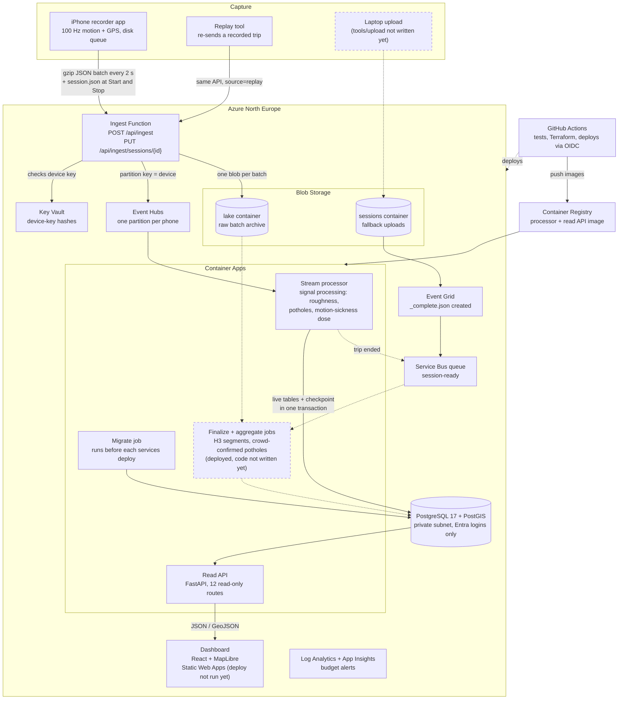

# DataInfrastructure_Chuds: Road & Ride

Codelap Hackathon 2026 (Porsche Engineering, "Data-Driven Infrastructure Engineering"). Road quality and motion sickness measured with phone sensors in cars, buses and trams, sent to Azure live while driving, processed, and shown on a map dashboard.



Solid boxes and arrows run today. Dashed ones are not working yet: the finalize and aggregate jobs exist in Azure but their code isn't written, the processor doesn't put "trip ended" on the queue yet, and the laptop upload script doesn't exist. The Event Grid → Service Bus wiring for fallback uploads is deployed.

- Plans and decision log: [decisions/](decisions/README.md)
- iPhone recorder spec: [decisions/01-initial-plan.md](decisions/01-initial-plan.md)
- Azure architecture and the reasons behind it: [decisions/02-infrastructure-plan.md](decisions/02-infrastructure-plan.md)

## Status (2026-11-21)

### Done and running on Azure

| Part | Where | What it does today |
|---|---|---|
| **Infrastructure (Terraform)** | [`infra/`](infra/README.md) | The whole stack in North Europe from one Terraform config: VNet, PostgreSQL 17 + PostGIS (private, Entra login only), Event Hubs, Service Bus, Blob Storage, Key Vault, Container Registry, Container Apps, the ingest Function app, Static Web App, Log Analytics, budget alerts. GitHub OIDC identities, no stored Azure secrets. |
| **Ingest function** | [`services/ingest/`](services/ingest/README.md) | `POST /api/ingest` and `PUT /api/ingest/sessions/{id}`. Checks the device key, then validates gzip, size, JSON and schema in the same order as the app's mock server. Sends each batch to Event Hubs (one partition per phone) and the raw archive. |
| **Database** | [`db/migrations/`](db/migrations) | Sessions, devices, batches, GPS track, labels, live state, stream checkpoints, chart series, events, pipeline state. A migrate job applies them on every deploy and creates the read/write database roles for the services. |
| **Stream processor** | [`services/processor/`](services/processor/README.md) | Reads Event Hubs and writes the tables above. Drops duplicates, keeps late batches off the live map, and marks a trip as ended once its Stop message and all batches are in. Each write commits together with the stream checkpoint, so a restart loses and repeats nothing. |
| **Signal processing** | [`services/processor/roadride/dsp.py`](services/processor/README.md#signal-processing-roadridedsppy) | Per batch: vertical acceleration, road roughness (1–30 Hz), the ISO 2631-1 Wf motion-sickness dose (MSDV), pothole detection above 15 km/h, and a 5 Hz chart series. It gives the same results fed batch by batch or as one whole trip. |
| **Read API** | [`services/read-api/`](services/read-api/README.md) | All 12 routes of [`dashboard/API.md`](dashboard/API.md), read-only. Hides the first and last 200 m of every trip for privacy. |
| **Replay tool** | [`tools/replay/`](tools/replay/README.md) | Re-sends a recorded trip through the live path as a new trip (`source=replay`, never aggregated), at real speed or faster. Used for the end-to-end test without driving, for the demo, and for tuning the pothole threshold on real data. |
| **CI/CD** | [`.github/workflows/`](.github/workflows) | Tests on every PR, including integration tests against a real PostGIS. Merges to `main` deploy the ingest function and the processor + read API (migrations first, then a check that every API route answers). |

### Done, waiting on one step

| Part | What's missing |
|---|---|
| **Dashboard** ([`dashboard/`](dashboard/README.md)) | Built, and the deploy workflow exists, but **deploy-dashboard hasn't been run yet**. Until it is, the website runs on its built-in mock data. Run it from the Actions tab: it points the site at the real read API and uploads it. |
| **iPhone app** ([`src/mobile-ios/`](src/mobile-ios/README.md)) | Built and tested by the team. The phone needs the ingest URL and a device key in its upload settings: `.\infra\scripts\add-device-key.ps1 -DeviceId <name>` creates the key. |
| **End-to-end test** | Every piece is tested on its own, and the deploys check the Azure logins. **No real batch has gone from a phone to the dashboard yet.** The first test is either a real drive or a [replay](tools/replay/README.md) of a recorded session folder. If the Live page stays empty, check the ingest function's logs first. |

### Not built yet

In the plan's build order:

1. **Speed bumps**: need the vehicle's pitch axis.
2. **Finalize job + road segments (H3) + aggregation**: turns finished trips into the shared roughness map and crowd-confirmed potholes. The Map page stays empty until this exists.
3. **Trip end on silence**: a trip whose Stop message never arrives stays "recording" for now; the plan closes it after 15 minutes.
4. From the plan's cut list: laptop upload fallback, monitoring workbook, Terraform plan on PRs.

## Repository

```
decisions/            plans, decision log, research notes
infra/                Terraform: bootstrap (state, OIDC) + main stack + modules; tf.ps1 runs it
services/ingest/      Azure Function (Python): the phone's front door
services/processor/   stream processor, signal processing, migrate job (one image)
services/read-api/    FastAPI read API for the dashboard
db/migrations/        SQL migrations
dashboard/            React + MapLibre + uPlot web app (mock backend built in)
src/mobile-ios/       the iPhone recorder (Swift)
tools/replay/         re-sends a recorded trip through the live path (Python, stdlib only)
.github/workflows/    CI and deploys
docker-compose.yml    local PostGIS for development
```

## Deploying

| What | How |
|---|---|
| Infrastructure | `cd infra; .\tf.ps1 apply` (settings in `infra/.env`, see [`infra/README.md`](infra/README.md)) |
| Ingest function | automatic on merge to `main` (`deploy-ingest`), or `services/ingest/deploy.ps1` |
| Processor, migrations, read API | automatic on merge to `main` (`deploy-services`) |
| Dashboard | manual: Actions → **deploy-dashboard** → Run workflow |
| A phone's device key | `.\infra\scripts\add-device-key.ps1 -DeviceId <name>` (prints the key once) |
| A replay of a recorded trip | `python tools/replay/replay.py <session folder or .zip>` with `$env:REPLAY_API_URL` and `$env:REPLAY_DEVICE_KEY` set ([tools/replay](tools/replay/README.md)) |
