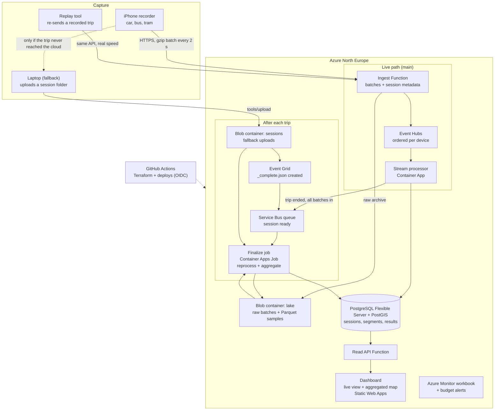

# Infrastructure plan: Azure backend

> **Status:** proposed, 2026-11-20. Moved from AWS to Azure the same day (D21 to D31 in the [decision log](README.md)). The AWS version, which was researched and reviewed by an independent advisor model, is in git history (commit `83e1dec`); everything that does not depend on the cloud (data model, processing, aggregation, data-quality rules) carries over unchanged. Later the same day, the **live path (phone → cloud → dashboard) became the main path**, with laptop upload only as a fallback (D32, D33). The app side is in [01-initial-plan.md](01-initial-plan.md); research sources are in [03-research-notes.md](03-research-notes.md).
>
> **Who this is for:** anyone on the team, including people who have not used these Azure tools before. Every tool is explained in plain words in §5, together with why we picked it and what we rejected.

---

## 1. The plan in one paragraph

Phones record trips (a "session") in cars, buses and trams and **send them to the cloud while driving**: every 2 seconds the app posts a batch of sensor data to an **ingest function**, which puts it into **Event Hubs** (a stream). A **stream processor** turns the batches into road-quality and motion-sickness numbers per small piece of road and stores them in a **PostgreSQL database with PostGIS** (maps support). The **web dashboard** shows the vehicle moving on the map, the road colouring in and the sickness score rising, a few seconds behind the phone. When a trip ends, a **finalize job** reprocesses the whole trip from the archived batches, and an **aggregation step** combines all trips, so every trip makes the shared map better. If the phone has no network, the app keeps the batches on disk and sends them later; only if a trip never reaches the cloud is its folder uploaded from a laptop, through the same finalize job. A **replay tool** sends a recorded trip through the live path, so we can show "live" in the presentation room without a car. Everything is created by **Terraform** (infrastructure as code) and deployed by **GitHub Actions** (CI/CD).

---

## 2. What changed

### From the first plan

| Topic | First plan | Now | Why |
|---|---|---|---|
| Cloud | Azure | **Azure**, region **North Europe** (Ireland) | We moved to AWS and back (see below). North Europe is a large, mature region with every service we need. |
| Where the data comes from | One test drive | **Many real trips** in cars, buses, trams, aggregated | More real data makes a better map and an honest story. No simulated cars. |
| How data reaches the cloud | Live upload | **Live upload is the main path**; laptop upload of session files is only a fallback | The product is phone → cloud → dashboard. Each batch carries every sensor at full rate, and the app's disk queue resends until the backend accepts it, so a bad network delays data but doesn't lose it. |
| Demo | Live drive | The **live dashboard** fed by a **replay** of a real trip through the live path, a **video** of a real drive, and if possible a car streaming live during the presentation | A presentation room has no moving car and unreliable Wi-Fi, so the replay is the safe version of the same path. |
| Streaming | Kafka considered | **Event Hubs (Basic)** | Same idea as Kafka, much less setup and cost at our volume. See §6. |

### From the AWS version (2026-11-20)

Why we went back to Azure:
- **The whole stack fits the free account.** On AWS, the new Free plan does not allow Kinesis or Firehose, so streaming would have forced the Paid plan, where anything above the credits goes on a card. On Azure everything here runs on the free account's $200 credit, and the account has a spending limit: when the credit runs out, resources stop instead of billing.
- **Some parts get simpler.** The PostgreSQL server is free for 12 months, Container Apps Jobs start the finalize job straight from the queue (on AWS this needed extra glue), and Static Web Apps hosts the dashboard for free.
- **No passwords at all.** Every service logs in to the database with its own Azure identity.

| AWS version | Azure now |
|---|---|
| S3 | Blob Storage |
| S3 event → SQS | Event Grid → Service Bus queue |
| ECS Fargate (processor, backfill) | Container Apps (processor) + Container Apps Jobs (finalize, aggregate, migrate) |
| ECR | Azure Container Registry |
| API Gateway + Lambda (ingest) | Azure Function with an HTTP trigger (no separate gateway) |
| Kinesis Data Streams | Event Hubs (Basic) |
| Firehose | The ingest function writes the raw archive itself |
| RDS PostgreSQL + PostGIS | Azure Database for PostgreSQL Flexible Server + PostGIS |
| RDS IAM login | Microsoft Entra login with managed identities |
| VPC, subnets, security groups | VNet, delegated subnets, network security groups |
| IAM roles | Managed identities + role assignments (RBAC) |
| Parameter Store + Secrets Manager + KMS | Key Vault; encryption at rest is on by default |
| S3 + CloudFront | Static Web Apps |
| CloudWatch + Budgets | Azure Monitor (Log Analytics, Application Insights) + Cost Management budgets |
| Terraform state in S3 | Terraform state in Blob Storage |
| GitHub OIDC → IAM role | GitHub OIDC → managed identity with a federated credential |

---

## 3. Does "collect a lot of real data" change the architecture?

Yes, in five places. The overall shape (capture, transmit, process, store, visualize) stays the same.

1. **The live stream is the dataset, not just a preview.** Each batch holds every sensor at full rate (only raw audio stays on the phone), and the app resends until the backend accepts it. So once a trip has ended and all its batches have arrived, a finalize job reprocesses it as a whole and it joins the dataset. Uploaded files are only needed when a phone never got a connection.
2. **A new aggregation layer.** We need to line up many trips on the same roads. That means fixed road segments (§8), a table of "one observation per session per segment", and a step that combines them. This is now core, not a stretch goal.
3. **Raw samples stay out of the database.** One hour of driving is about a million sensor rows. Fifty hours would be about fifty million rows, too much for a small database. So raw samples stay in Blob Storage as files (converted to Parquet, a compact column format), and the database only stores results: segments, events, a light track, and downsampled chart data. This keeps the database small and cheap no matter how much we drive.
4. **Every session carries its context.** Vehicle type, bus line, how the phone was mounted, seated or standing. Without that, a bumpy bus would look like a bumpy road. Normalization between vehicles is in §9.
5. **Data quality rules.** Some sessions will be bad (hand-held phone, phone moved). The pipeline marks them and keeps them out of the aggregated map automatically.

How much data is "a lot"? Expect about **5 to 15 sessions** in the time we have. The story to tell is "the method gets better with every trip", not "big data". Storage is no problem either way: each hour is about 100 to 150 MB (CSV plus audio), so even 50 hours is under 10 GB.

---

## 4. Architecture diagram



---

## 5. Every component: what it is, why we chose it

Read this section if a tool name is unfamiliar. Each entry says what the tool is in plain words, what job it does for us, and what we considered instead.

### Capture side

**iPhone recorder app** (built by our teammate, see [01-initial-plan.md](01-initial-plan.md)). Writes every sensor to CSV files on the phone first, so nothing is lost if the network fails. Every 2 seconds it builds a batch with all sensors at full rate (everything except raw audio), saves it in a **queue on disk**, and sends the queue oldest first, retrying with backoff until the backend accepts each batch. A dead zone therefore delays data, it doesn't lose it. It also sends the session's metadata (`session.json`: vehicle, mount, seat, posture) at Start and again at Stop, through the same queue, so the backend knows the context and when the trip ended. This metadata call is a **small addition to the app** (spec §6.1).

**Laptop upload (fallback)** (`tools/upload`, a few lines wrapping `azcopy copy --recursive` after `azcopy login`). Only for a trip that never reached the cloud (no network at all, upload switched off, or the app's queue was cleared). The session folder is AirDropped to a laptop and uploaded with one command. The script uploads all files first and writes a small `_complete.json` marker **last**, so processing never starts on a half-uploaded folder. Team members log in with their own Azure account; they need the "Storage Blob Data Contributor" role on the `sessions` container.

**Replay tool** (`tools/replay`, a small Python script). Reads a recorded session folder, builds the same 2-second batches the phone would send, and posts them to the real API at real speed (or faster). It is our end-to-end test before every drive, and our backup demo: in the room we can show the map updating live from a real trip. Replays are tagged `source=replay` with a new session ID, and are never counted in the aggregated map, so nothing is counted twice.

### Getting data into Azure

**Azure Functions (ingest function, Flex Consumption plan).** Azure Functions runs a small piece of code only when a request arrives; you pay per run, and it costs nothing when idle. An HTTP-triggered function already has a public HTTPS address with a certificate, so we don't need a separate API gateway. It serves three routes:

| Route | What it does |
|---|---|
| `POST /api/ingest` | one 2-second batch (spec §6) |
| `PUT /api/sessions/{sessionId}` | the session's metadata, sent at Start and at Stop (spec §6.1) |
| `GET /api/health` | the app's connection test before a drive |

For each batch or metadata message the function:
- checks the `x-device-key` header against hashed device keys (stored in Key Vault, loaded once at start-up, compared in constant time so timing can't leak them);
- decompresses the gzip body and checks its format (with pydantic, a Python validation library), and rejects bodies over 200 KB;
- sends it to Event Hubs as **decompressed JSON**, marked `kind=batch` or `kind=session`, with the **device ID as the partition key**, so a phone's metadata and batches stay in the order the phone sent them;
- writes it to the raw archive under `lake/raw/session=<sessionId>/` (`<batchSeq>.json.gz` or `session.json.gz`), then answers `200`.

The archive file name comes from the message itself, so if the phone retries, the same file is simply overwritten: no duplicates in the archive. Duplicates in the stream are removed later in the database (§8). The archive is the long-term copy of every trip: the finalize job rebuilds a whole trip from it.

It runs **outside** our private network (VNet) on purpose: it then needs no network setup and reaches Event Hubs, Blob Storage and Key Vault directly over their public, login-protected endpoints. Abuse is limited by the device keys and by a cap on how many copies of the function may run at once (`maximum_instance_count`), so a flood of bad requests can't run up the bill.

*Rejected:* API Management (an extra service and extra configuration for what the function already does; it can be put in front later if we need per-client throttling).

*Why no duplicate check here?* The AWS design once wrote a "seen" record to a separate store first. The advisor found a data-loss bug: if that record was written but the next step failed, the phone's retry would get "duplicate" and delete the batch, and the data would be gone. Duplicates are removed in the database instead (§8), where it is safe.

**Event Hubs (Basic tier, 1 throughput unit, 2 partitions).** A stream is an ordered, durable log of messages. Producers append to it; consumers read from it at their own pace. Messages stay for 1 day, so if the processor crashes or is redeployed, nothing is lost: it continues where it stopped. Messages are split into "partitions" by a key; we use the **device ID**, so each phone's batches stay in order, which our filters need.

*Why have a stream at all, with only a few phones?* Honestly, not for volume. We keep it because it:
- **decouples** receiving data from processing it, so the phone always gets a fast answer even if processing is slow or down;
- keeps **order per device**, which matters because the filters carry state from one batch to the next, and because the Stop metadata must arrive after the trip's last batch;
- **buffers** a day of data, so a processor crash or redeploy during a drive loses nothing;
- costs about **$0.36 per day**.

Basic tier limits that matter: one reader group (fine, only the processor reads; the archive is written by the ingest function), 256 KB per message (a batch is about 30 KB), 1 day of retention. *Rejected:* Event Hubs Standard with **Capture**, which writes the stream to storage by itself, like Firehose. Capture costs extra per hour on Standard and writes Avro files instead of plain JSON; a few lines in the ingest function do the same job for free. See §6 for Kafka and others.

### Processing: live, then once more per trip

**Stream processor.** Reads Event Hubs continuously and handles each message within a second or two:
- a `session` message creates or updates the trip and its context (vehicle, mount, seat);
- a `batch` message runs the same calculations as the full pipeline (§9), incrementally: it updates the vehicle's live position and scores, writes segment observations as each 25 m hexagon is passed, adds detected potholes and the downsampled chart data;
- it records how far it has read in the same database transaction, so a restart continues exactly where it left off.

Gaps and late data. If a batch number is skipped (still queued on the phone, or rejected), the processor resets its filters at the gap and flags it; when a dead zone ends, the phone sends a burst of older batches, which the dashboard shows as "catching up" rather than live. These live results are good enough to watch, and the finalize job replaces them with exact ones.

**Trip end.** A trip is ready when its Stop metadata has arrived (it carries the number of batches) and every batch up to that number is in. The processor then puts a "session ready" message in the Service Bus queue. If no Stop arrives (app crashed, phone died), a trip with no new batch for 15 minutes is closed as incomplete and finalized anyway, with its gaps marked.

**Finalize job.** Runs once per finished trip, a few seconds after it ends. It reads the whole trip, either from the raw archive (live trips) or from the uploaded folder (fallback), recomputes everything over the complete trip in one pass (no gaps, filters run over the whole signal), writes Parquet samples to `lake`, replaces the trip's live results in the database, then runs the aggregation step (§9). If a trip arrives both ways, the uploaded folder wins, since it also has the samples a failed batch may have lost.

**Blob Storage.** Azure's file storage ("containers" of files in a storage account). Very cheap, very durable, and the place where all raw data lives. We use two containers:
- `lake`: the raw live archive and processed Parquet files;
- `sessions`: fallback uploads of session folders, exactly as recorded.

Public access and storage keys are switched off; everything logs in with an Azure identity.

**Parquet.** A compressed, column-based file format used for analytics. A 100 Hz sensor file shrinks a lot, and pandas reads it fast.

**Event Grid.** Azure's event router, used only by the fallback upload. When a file whose name ends in `_complete.json` is created in `sessions`, Event Grid puts a message in the Service Bus queue. The filter is set in Terraform, so other files don't trigger anything.

**Service Bus (Basic tier) queue.** A queue of small "to-do" messages: "session X is ready", sent by the processor (live trips) or by Event Grid (uploads). The finalize job takes a message, processes the session, and completes the message. If processing fails, the message comes back and is retried; after 5 failed tries it moves to a **dead-letter queue**, so one broken session can't loop forever. Costs a few cents per million messages. *Rejected:* Storage Queues (no dead-letter queue built in), RabbitMQ (something to run and secure).

**Azure Container Apps.** Runs Docker containers without us managing servers. We use it for two things:
- the **stream processor**: a long-running container app (always 1 copy) that reads Event Hubs continuously;
- **Container Apps Jobs**: containers that run to completion and stop. The **finalize job** is started automatically by the Service Bus queue: when a message arrives, Azure starts one copy, which processes that session and exits. Two more jobs, **aggregate** and **migrate**, are started by hand or by CI (see below).

All of them run the **same Python code** (numpy and scipy for signal processing). *Why not Functions for processing?* The filters keep state for minutes (motion-sickness dose accumulates over a whole trip), and functions are short-lived and stateless. A container can keep that state in memory and checkpoint it to the database.

Setup details:
- The finalize job uses a KEDA rule (Azure's built-in autoscaler) on the Service Bus queue: 0 copies when the queue is empty, at most 3 at once, a 30-minute time limit per run.
- A long session can take longer than the 5-minute message lock, so the job renews the lock while it works (`AutoLockRenewer` in the Service Bus SDK).
- The processor needs no incoming traffic, so the environment is **internal**: nothing in it is reachable from the internet.

**Azure Container Registry (ACR).** Where our Docker images are stored so Container Apps can run them. CI pushes a new image on every merge. Containers pull images with their own identity; the registry's admin password is switched off.

### Storage and results

**Azure Database for PostgreSQL Flexible Server** (Burstable `B1ms`, 1 vCore, 2 GB RAM, 32 GB storage, PostgreSQL 17, no high availability). A managed database: Azure runs PostgreSQL for us, including backups and patching. It is **free for 12 months** on a new free account (750 hours a month, so it can run all the time). The small size is enough because only results go in (see §3). It sits in a **private subnet**, unreachable from the internet. *Rejected:* Azure SQL Database (has a free offer, but no PostGIS), Cosmos DB (no map queries), Azure Data Explorer (another query language to learn).

**PostGIS.** A PostgreSQL extension for geographic data: it stores points, lines and polygons and answers questions like "which road segments are within 20 m of this GPS point". The map runs on it. On Azure it must be allow-listed first (server parameter `azure.extensions = POSTGIS`, set in Terraform) before the migration runs `CREATE EXTENSION postgis`.

**H3.** Uber's open-source system that covers the Earth with hexagons of fixed sizes. We assign every GPS point to a small hexagon (about 25 m across) in Python, so that different trips on the same street land in the same cells and can be compared. It needs no map data import. Snapping to real OpenStreetMap roads was considered and dropped (§19).

**Database logins: Microsoft Entra, no passwords.** Password login is switched off on the server. Every service has its own **managed identity** (an Azure identity attached to the service, with no secret to store) and logs in with a short-lived token from it:

| Database user | Used by | Rights |
|---|---|---|
| `migrator` (the server's Entra admin) | migrate job | creates PostGIS, tables and the other users |
| `writer` | stream processor, finalize and aggregate jobs | read and write on our tables |
| `reader` | read API function | `SELECT` only |

Setup details:
- Turn on Entra authentication and turn off password authentication in Terraform; make the migrate job's identity the Entra admin.
- The migrate job creates the other users with `pgaadauth_create_principal_with_oid(...)`, then grants rights.
- Tokens are requested for `https://ossrdbms-aad.database.windows.net/.default` and used as the password. A token is only needed to *open* a connection; keep the connection in a global variable and reconnect (with a fresh token) when it fails.
- TLS is required: connect with `sslmode=verify-full` and ship the Azure root certificates (DigiCert Global Root G2 and Microsoft RSA Root CA 2017) with the code.

**Migrations run once, in their own job.** PostGIS and tables are created by SQL migrations (`db/migrations/`). CI starts the **migrate job** before updating the processor, so two containers can never run migrations at the same time.

### Dashboard

**What the dashboard shows.** The web app is where the whole system becomes visible, so it is built around the live path:

| View | What you see | Fed by |
|---|---|---|
| **Live** (the main screen) | The map follows each vehicle that is sending. The road behind it colours in hexagon by hexagon (roughness), pothole and speed-bump markers pop up as they are detected. A side panel shows speed, current roughness, motion-sickness dose so far and the predicted share of sick passengers, the passenger's latest MISC rating, and how fresh the data is (seconds behind the phone, "catching up" after a dead zone). | stream processor, updated every 2 s |
| **Map** | All finished trips combined: hexagons coloured by normalized roughness or sickness score, filtered by vehicle type; confirmed potholes. | finalize job + aggregation |
| **Trip** | One trip: vertical and sideways acceleration, speed and sickness dose over time, with the MISC ratings on top; its track on the map; the data-quality panel (§10). | finalize job (live results while the trip is running) |

End-to-end delay target: under 10 seconds from the phone to the screen (2 s batch, upload, stream, processing, 2 s polling). The processor stores when each batch arrived, so the dashboard can show the real delay instead of claiming "live".

**Read API function.** A second, separate function app. It only reads from the database and returns JSON and GeoJSON (map data) to the dashboard: `/api/live`, `/api/trips`, `/api/trips/{id}`, `/api/segments`. It is connected to the VNet because the database is private, and it logs in as `reader` with its managed identity.

**React + Vite + MapLibre + uPlot, hosted on Static Web Apps.**
- *React + Vite*: a common way to build a web app; Vite is the build tool.
- *MapLibre GL JS*: an open-source map library, with free OpenFreeMap tiles (the background map). We colour road segments by roughness or sickness score.
- *uPlot*: a very fast chart library for long time series.
- *Azure Static Web Apps (Free plan)*: hosts the built website (plain files) over HTTPS from a global network. Free.

The read API allows browser requests (CORS) only from the dashboard's Static Web Apps address; Terraform passes that address to the function app in the same run. The dashboard learns the API address at build time from a Terraform output. It polls the read API every 2 to 5 seconds when showing live data. *Rejected:* WebSockets or SignalR (more moving parts for a handful of viewers), Front Door + Storage static website (Front Door has a monthly base fee).

### Running and watching it

**VNet (virtual network).** Our own private network in Azure, split into subnets:
- a subnet for the **database** (handed over to PostgreSQL), unreachable from the internet;
- a subnet for the **Container Apps environment** (processor and jobs);
- a subnet for the **read API function**.

A private DNS zone lets our services find the database by name. Network security groups (Azure's firewall rules) allow the database only from our own subnets. *Why not a NAT gateway* (the usual way to give private machines internet access)? It costs about $1 per day plus data, and we don't need it: the subnets keep Azure's default outbound access (set explicitly in Terraform, because new VNets no longer get it automatically), and Storage, Event Hubs and Service Bus are reached through free service endpoints or their login-protected public endpoints.

**Managed identities and role assignments.** Azure's permission system. Each service gets its own identity with only the roles it needs:

| Identity | Roles |
|---|---|
| ingest function | send to the event hub; write to `lake`; read the device-key secret |
| processor and jobs | read from the event hub; send to and receive from the queue; read `sessions`; read and write `lake`; pull images; database `writer` |
| migrate job | database Entra admin; pull images |
| read API function | database `reader` |
| Event Grid | send to the Service Bus queue |

Event Hubs, Service Bus and Storage have **key-based access switched off**, so there are no connection strings to leak.

**Key Vault.** Azure's store for secrets. It keeps the hashed device keys, which the ingest function reads through a Key Vault reference in its settings. There are no database passwords to store. Encryption at rest for Storage, PostgreSQL and Event Hubs is on by default with Microsoft-managed keys; we don't need our own keys.

Nothing secret is ever committed to the repo.

**Azure Monitor: Log Analytics and Application Insights.** Azure's logs, metrics and alerts. All services send logs and traces to one Log Analytics workspace (with a daily cap so logs can't run up the bill). One **workbook** (an Azure dashboard), defined in Terraform, shows ingest rate, errors, Event Hubs incoming messages, **processor lag** (now minus the time of the last processed message, a custom metric the processor reports), rows written and data-quality counts. An action group emails us on errors and lag.

**Cost Management budget.** Sends an email when spending crosses $20 and $50, so a forgotten resource can't surprise us. On the free account, the spending limit is a second safety net: when the credit is used up, resources are stopped, not billed.

### Building and deploying

**Terraform.** Infrastructure as code: we describe every Azure resource in `.tf` files (the `azurerm` provider), and Terraform creates, changes or deletes the real resources to match. `terraform plan` shows what would change; `terraform apply` does it. The current state is stored in a Blob Storage container, which locks it automatically, so two people can't apply at once. Because storage keys are off, the provider uses Entra login for storage (`storage_use_azuread = true`, and `use_azuread_auth = true` in the backend). We write plain `azurerm` resources and use Azure Verified Modules only where they clearly save time.

**GitHub Actions.** CI/CD inside GitHub: workflows run on every pull request and every merge. They log in to Azure with **OIDC**: GitHub proves which repo and branch a job comes from, Azure trusts that through a **federated credential** on a managed identity, and hands out short-lived tokens (`azure/login@v2`). No Azure secrets are stored anywhere; the client, tenant and subscription IDs are plain repo variables.

**Docker Compose (local development).** Runs PostgreSQL with PostGIS on a laptop. The processor can run directly on session CSV files, so most development and testing needs no Azure at all.

---

## 6. Why not Kafka, RabbitMQ and other popular tools

We looked at each seriously. The guiding rule: use a tool when the data or the demo needs it, not to fill the slide.

| Tool | What it would do | Why not (for us, now) |
|---|---|---|
| **Event Hubs Standard (Kafka endpoint) + Capture** | Stream with Kafka clients and automatic archive | Twice the base price, and Capture is billed per hour on top. Basic does what we need. |
| **Self-hosted Kafka or Redpanda on a VM** | Same, "real" Kafka | We'd have to run, secure and fix a broker ourselves. |
| **Service Bus Standard with sessions** | Ordered messages per device | Works, similar price, but a queue forgets messages once read, so the processor can't re-read the last hours after a bug. |
| **RabbitMQ** | Job queue | Service Bus does the same job with nothing to run and costs cents. |
| **IoT Hub** | Device messaging | The free tier counts messages in small chunks, so one drive would use up the daily quota; per-device registration and certificates add setup. HTTPS plus device keys gives a similar security story. |
| **Stream Analytics** | Stream processing engine | Its SQL-like language can't run numpy and scipy, and it bills every hour it runs. |
| **Durable Functions** | Stateful serverless code | Possible, but long numpy filters with minutes of state fit a plain container better. |
| **Cosmos DB** | Duplicate check | Same data-loss risk as the old DynamoDB idea; the database handles duplicates safely. |
| **Azure SQL Database (free offer)** | Database | No PostGIS. |
| **AKS (Kubernetes)** | Container platform | Nodes cost money all the time and it takes days to set up; Container Apps does what we need. |
| **API Management** | API gateway | The function already has HTTPS; it can be added later for throttling. |
| **NAT gateway, private endpoints** | Private internet access, private service access | About $1 per day each; not needed at our scale (see VNet in §5). |
| **A second CI/CD system (Azure DevOps)** | More pipelines | Adds nothing judges can see; GitHub Actions covers everything. |

If the project ever grows to thousands of vehicles, the design moves to Kafka cleanly: switching Event Hubs to Standard turns on its Kafka endpoint, and the stream sits behind the ingest function, so phones would not change.

---

## 7. How the data flows

**During a trip (main path).**
1. At Start, the app sends the session metadata (`PUT /api/sessions/{id}`). The trip appears on the dashboard with its vehicle and context.
2. Every 2 seconds the phone (or the replay tool) posts a gzip batch to the ingest function. Without network, batches wait in the app's disk queue and are sent oldest first when the network returns.
3. The ingest function checks each message, sends it to Event Hubs keyed by device, and writes it to the raw archive.
4. The stream processor reads the messages in order, runs the calculations incrementally, and writes live state, segment observations, events and chart data. It records how far it has read (the partition's sequence number, in `stream_checkpoints`) in the same database transaction.
5. The dashboard polls the read API every 2 seconds: the vehicle moves, the road colours in, the sickness dose rises.

**When the trip ends.**
1. At Stop, the app sends the metadata again, now with the end time and the number of batches. It goes through the same queue, so it arrives after the last batch.
2. Once every batch is in, the processor puts "session ready" in the Service Bus queue (or after 15 minutes of silence, as incomplete).
3. Container Apps starts the finalize job: it rebuilds the trip from the raw archive, recomputes it in one pass (§9), writes Parquet to `lake`, replaces the trip's live results, and runs the aggregation step.
4. The trip now counts in the aggregated map.

**Fallback: a trip that never reached the cloud.**
1. `tools/upload` copies the session folder to the `sessions` container under `<sessionId>/` and writes `_complete.json` last.
2. Event Grid puts "session ready" in the same queue; the same finalize job reads the CSVs instead of the archive.
3. If part of the trip had arrived live, the uploaded files win: the job replaces that trip's results, so nothing is counted twice (the app uses the same `sessionId` for both).

---

## 8. Data model (PostgreSQL + PostGIS)

| Table | One row per | Key fields |
|---|---|---|
| `vehicles` | vehicle | type (car/bus/tram), make/model, line |
| `devices` | phone | device ID, hashed key |
| `sessions` | trip | vehicle, device, mount (rigid, handheld, location), rater seat and posture (from `session.json`), `source` (`live`/`upload`/`replay`), `status` (`recording`/`ended`/`finalized`, plus `incomplete`), expected batch count, quality status, `include_in_agg` |
| `ingest_batches` | live batch received | (session_id, batch_seq) **unique**: a repeated batch is ignored with `ON CONFLICT DO NOTHING`; arrival time, for the delay shown on the dashboard |
| `stream_checkpoints` | Event Hubs partition | last sequence number processed |
| `segments` | road piece | H3 cell ID, geometry |
| `segment_observations` | session × segment × pass | speed, raw roughness, MSDV contribution, sample count, quality flags |
| `events` | detected pothole or speed bump | position, time, type, confidence, session |
| `labels` | manual tap or rating | type, value, time (from the app's `labels.csv`) |
| `session_series` | downsampled chart data | about 5 Hz vertical and lateral acceleration, speed, MSDV so far |
| `live_state` | device | last position, speed, current scores (for the live view) |
| `segment_agg` | segment × vehicle type | normalized roughness, pothole confirmation ratio, sickness score, number of sessions; rebuilt by the aggregation step |

`include_in_agg` is true only for **finalized** trips (live or uploaded, never replays) whose context is known and that pass the quality rules (§10).

Raw values are always stored as measured; normalization happens only in the aggregation step, so we can change the method later without reprocessing.

**Road segments.** We use **H3 hexagons** (about 25 m). Two trips on the same street fall in the same cells, which is what aggregation needs, and it requires no map import. Its weakness: it can blur two parallel roads or a junction. Watch for that when picking the drive loop.

---

## 9. Processing and aggregation

**Per session** (the same code runs live, batch by batch, and in the finalize job over the whole trip):
1. **Clock alignment.** Convert all timestamps to UTC using the clock anchors (`clock.csv`).
2. **Phone-to-vehicle axes.** Use gravity at rest for "down" and GPS course or the main direction of acceleration for "forward". Everything else depends on this step.
3. **Quality checks.** Measure sample rates and gaps. Mark windows invalid when `phone_moved` was tapped, when gravity drifts in the phone's frame, or when the gyro's turn rate disagrees with GPS. Report what fraction of the session is valid.
4. **Road roughness.** Band-pass vertical acceleration (about 1 to 30 Hz), compute RMS per segment pass, and record speed with it.
5. **Potholes and speed bumps.**
   - A pothole is a sharp jump in high-passed vertical acceleration, counted only above 15 km/h.
   - A speed bump shows a double peak in pitch rate (front axle, then rear axle).
   - Detections are scored against manual taps within ±1.5 s, since people react late, as precision and recall.
6. **Motion sickness.**
   - Vertical acceleration through the ISO 2631-1 Wf filter (f1 0.08, f2 0.63, f4 0.25 with Q 0.86, f5 0.0625 with Q 0.80, f6 0.1 with Q 0.80 Hz), then MSDV = √(∫a_w² dt). Roughly MSDV/3 percent of unadapted people may vomit.
   - The prediction is compared against the passengers' MISC ratings.
   - The filter has a unit test checking its frequency response against reference values.
   - Known limit, to state openly: the ISO metric only covers up-and-down motion, while in cars sideways sway is likely a strong cause of sickness. A sideways metric was considered and dropped (§19).

**Across sessions** (the aggregation step). It runs at the end of every finalize job, and can be re-run by hand with the **aggregate** job (for example after changing the method). It takes a PostgreSQL advisory lock, so two runs never overlap, and rebuilds `segment_agg` in one transaction.
- **Roughness is normalized per vehicle.** A bus and a car feel the same road differently. We fit one model across all observations: `log(roughness) = road segment effect + vehicle effect + β·log(speed)`. Segments driven by several vehicles tie the vehicle effects together. If there is too little overlap, the fallback is per-session percentiles.
- **Potholes are crowd-confirmed.** A pothole counts as confirmed when it was detected in at least *k* of *n* passes over that segment, with thresholds set per vehicle type.
- **Sickness is not normalized.** It measures what passengers actually feel, so "the bus is worse than the car on this route" is a finding, not an error. Results are split by seat and by seated or standing.

**Plan the trips for overlap.** Crowd confirmation only works if the same streets are driven several times. Pick one fixed loop that shares streets with a bus or tram line, and drive it several times, including at two different speeds.

---

## 10. Data quality and session rules

- **A rigid mount is required for roughness.** Tape or clamp the phone; run the stillness preflight. Sessions with `mount.rigid = false` or `handheld = true` are excluded from roughness and marked "experimental" for sickness.
- **Buses.** Frequent stops, door cycles, kneeling and idling engines are separated using speed near zero and the activity data.
- **Trams.** Rail joints cause regular, repeating impacts. They are labelled as rail joints so they don't count as potholes.
- **Audio is off on public transport** (other passengers, GDPR).
- **Only finalized trips count in aggregates.** A trip still recording, or one whose context (vehicle, mount) never arrived, shows on the live view but not in the aggregated map. Replays never count.
- A **data-quality panel** on the dashboard shows per session: sample rates, gaps, GPS accuracy, valid fraction and rejected batches.

---

## 11. Security

| Concern | Measure |
|---|---|
| Data in transit | HTTPS only (functions, Static Web Apps), TLS 1.2 minimum; database connections require TLS with certificate checks |
| Who may send data | Per-device keys, stored only as hashes in Key Vault, compared in constant time; strict payload validation and a size limit |
| Data at rest | Storage, PostgreSQL and Event Hubs encrypted by default; blob public access off |
| Database exposure | Private subnet only, no public access; password login off, Entra login only |
| Permissions | One managed identity per service, least privilege; key-based access off on Storage, Event Hubs and Service Bus |
| CI/CD credentials | GitHub OIDC with federated credentials; no stored Azure secrets; deploy identity usable only from the protected `prod` environment |
| Secrets in the repo | None; gitleaks scans every push |
| Privacy | Raw audio never uploaded live; audio off on public transport; GPS trimmed near trip start and end on the public dashboard |

---

## 12. Infrastructure as code (Terraform)

```
infra/
  bootstrap/          # run once by hand: state storage account, GitHub identities + federated credentials, resource provider registration
  main/               # the whole stack (one cloud environment)
    main.tf  variables.tf  outputs.tf  backend.tf (azurerm, use_azuread_auth = true, use_oidc = true)
  modules/
    network/          # VNet, subnets (database, Container Apps, read function), NSGs, service endpoints, private DNS zone
    storage/          # storage account, containers (sessions, lake), Event Grid subscription to Service Bus
    messaging/        # Service Bus (Basic) queue + dead-letter, Event Hubs (Basic) namespace + hub
    database/         # PostgreSQL Flexible Server, server parameters (azure.extensions, TLS), Entra admin
    compute/          # ACR, Container Apps environment, processor app, finalize/aggregate/migrate jobs, both function apps, Key Vault, identities + role assignments
    web/              # Static Web App for the dashboard
    observability/    # Log Analytics, Application Insights, workbook, alerts, budget
```

- **One cloud environment plus local**, not dev and prod copies; that halves cost and wiring.
- **One resource group** for the stack, so `terraform destroy` (or deleting the group) removes everything.
- Terraform owns resource definitions; CI only ships new code and images. Terraform ignores those fields (`lifecycle { ignore_changes }` on image tags), so plan and deploy don't fight.
- The CI deploy identity needs Contributor plus "Role Based Access Control Administrator" on the resource group, because Terraform creates role assignments.

---

## 13. CI/CD (GitHub Actions)

| Workflow | Runs when | What it does |
|---|---|---|
| `python-ci.yml` | PR touching `services/**` or `tools/**` | ruff (lint), pytest (including the Wf filter test and a test on a sample session) |
| `terraform-plan.yml` | PR touching `infra/**` | fmt, validate, plan; posts the plan as a PR comment; read-only identity |
| `terraform-apply.yml` | merge to `main` touching `infra/**` | apply, after approval in the protected `prod` environment |
| `deploy-services.yml` | merge to `main` touching `services/**` or `db/**` | build images, push to ACR, run the migrate job and wait for it, update the processor and jobs, deploy both function apps |
| `deploy-dashboard.yml` | merge to `main` touching `dashboard/**` | build, deploy to Static Web Apps (the deploy token is fetched with `az` after OIDC login, not stored) |
| `security.yml` | every PR | gitleaks (scans for committed secrets) |
| `teardown.yml` | manual | `terraform destroy` after the hackathon |

---

## 14. Cost estimate

Approximate, North Europe prices; verify in the Azure Pricing Calculator.

| Item | Approx. per day |
|---|---|
| Event Hubs Basic, 1 throughput unit (exists 24/7) | ~$0.36 |
| PostgreSQL Flexible Server `B1ms` + 32 GB | $0 for 12 months on the free account (~$0.55 after) |
| Container Apps processor (0.25 vCPU, 0.5 GB, always on) | $0 for the first ~8 days each month (monthly free grant), then ~$0.45 |
| Container Apps Jobs (finalize, aggregate, migrate) | ~$0 (minutes per session) |
| Functions (Flex Consumption) | ~$0 at our volume |
| Container Registry | $0 to ~$0.17 (Basic) |
| Storage, Event Grid, Service Bus, Key Vault, Log Analytics (capped), Static Web Apps (Free) | < $0.20 |
| **Total** | **≈ $0.50 to $1.50 per day** |

The free account gives **$200 of credit for 30 days**, which covers the hackathon many times over. After 30 days the account must be upgraded to pay-as-you-go to keep running; the 12-month free services continue after the upgrade. Run `teardown.yml` after the event.

---

## 15. Repository layout

```
decisions/            # this folder: plans and decision log
src/mobile-ios/       # iPhone app (teammate, built on a Mac)
services/
  ingest/             # Function app: validate, send to Event Hubs, archive
  read-api/           # Function app: dashboard queries
  processor/          # shared Python package + entry points: stream, finalize, aggregate, migrate
tools/
  upload/             # fallback: upload a session folder to Blob Storage, marker file last
  replay/             # re-send a recorded session through the live API
  quick_check/        # sanity check of a session folder (from the initial plan §10)
dashboard/            # React + MapLibre + uPlot
db/migrations/        # SQL: PostGIS, tables, users
infra/                # Terraform (see §12)
.github/workflows/    # see §13
docker-compose.yml    # local PostGIS
```

---

## 16. Build order and what to cut

**Day 0 (setup).**
- Create the Azure free account (or Azure for Students, if a team member qualifies: no card needed). The 30-day credit clock starts now.
- Register the resource providers the stack needs (`Microsoft.App`, `Microsoft.EventHub`, `Microsoft.ServiceBus`, `Microsoft.EventGrid`, `Microsoft.DBforPostgreSQL`, `Microsoft.Web`, `Microsoft.ContainerRegistry`, `Microsoft.OperationalInsights`); `infra/bootstrap` does this.
- Check that `B1ms` PostgreSQL and Flex Consumption are available in North Europe for this subscription.
- Create the budget, run `infra/bootstrap`, and set up OIDC.

**Day 1: the thin live slice first.**
- Morning: phone (or replay tool) → ingest function → Event Hubs → processor → PostgreSQL → read API → a dot moving on the dashboard map. No signal processing yet, just position and speed. Once this works end to end, every later step only adds detail to a path that already runs.
- Early check in that slice: the read API function can get an Entra token and connect to the private database (this exercises the VNet's outbound access).
- In parallel: processing on the first real session folders, locally (this is where the value is); Terraform; CI workflows; the app's session metadata call (spec §6.1).

**Day 2.**
- Plug the processing into the processor: roughness colouring, potholes, sickness dose on the live view.
- Trip end detection, finalize job, segments, aggregation, the Map view.
- Real drives on the loop, watched live.

**Day 3.** Fallback upload path, monitoring workbook, data-quality panel, tests, README and architecture slide, rehearsal, recording the live video.

**Cut in this order if time runs out:** monitoring workbook (keep the budget alerts) → laptop upload fallback (the app's queue covers most network gaps) → aggregated Map view (keep Live and Trip).

**Never cut:** the live path from phone to dashboard, real data on the map, Terraform, CI/CD.

---

## 17. Top risks

1. **Account limits.** The free account's credit lasts 30 days and some sizes may be unavailable in the region. Fix on day 0; fall back to West Europe if needed.
2. **Network surprises.** New VNets no longer have outbound internet by default; if Terraform doesn't keep it on, the read function can't get a database token. Test on day 1, not day 3.
3. **The app's metadata call isn't ready.** Without it the backend doesn't know the vehicle or when a trip ended. Fallback: the processor creates the trip from its first batch with unknown context and closes it after 15 minutes of silence; such trips stay out of the aggregated map until their folder is uploaded.
4. **Bad recordings:** loose mount, clock problems, wrong axes. Do a 10-minute dry run, watch it live on the dashboard, and check the folder with `quick_check` before the first real drive.
5. **Mobile network on the route.** Dead zones delay data (the queue catches up) but don't lose it. Pick a loop with decent coverage so the live view looks live.
6. **Not enough overlapping trips** for aggregation. Plan a fixed loop and repeat it.
7. **Live parts fail in the room** (Wi-Fi, function cold start). The replay through the real live path is the main demo; the video of a real drive is the backup.
8. **Expert questions on the method** (few raters, timing noise). Be open about it, and tune on some sessions and test on others.

---

## 18. Open questions

- Free account or Azure for Students, and whose card or student account?
- Can the app's session metadata call (spec §6.1) be added on day 1?
- Can a car stream live during the presentation (organizers, parking, mobile coverage), or do we show the replay only?
- Which loop will we drive repeatedly, and which bus or tram line overlaps it?
- Who owns which part (processing, infra, dashboard, app)?
- When is the dry run?
- How much GPS trimming do we want on the public dashboard and in the public repo?

---

## 19. Dropped from scope (2026-11-20)

These were in earlier versions of the plan. We removed them because they mainly added polish, not value, for a 3-day build. Each can be added back later without changing the rest of the architecture.

| Dropped | What it would have given | Why it's dropped | If we ever want it back |
|---|---|---|---|
| SQL on raw files (Athena + Glue on AWS) | SQL queries directly on raw files in storage | Nobody would use it in 3 days; pandas on the Parquet files does the same job | DuckDB on the `lake` container, or Synapse serverless SQL; the `session=` folders already fit |
| OpenStreetMap road snapping | Segments that follow real roads, no blurring at junctions or parallel roads | H3 hexagons are good enough for aggregation and need no map import | Import an OSM extract, cut roads into 25 m pieces, add a road ID to `segments` |
| Lateral (sideways) sickness metric | A second, non-standard sickness score based on Donohew & Griffin (2004) | Scientifically interesting, not required. The ISO vertical metric covers the requirement | The lateral acceleration is still stored in `session_series`, so the metric can be computed later from existing data |
| checkov in CI | Automatic checks for Terraform misconfigurations | Extra checks that judges rarely open; gitleaks stays for secrets | Add one step to `security.yml` |
| iOS build check in CI | Unsigned simulator build of the app on a macOS runner | The app is built and tested on the Mac anyway | Add an `ios-build.yml` workflow with a path filter on `src/mobile-ios/**` |
