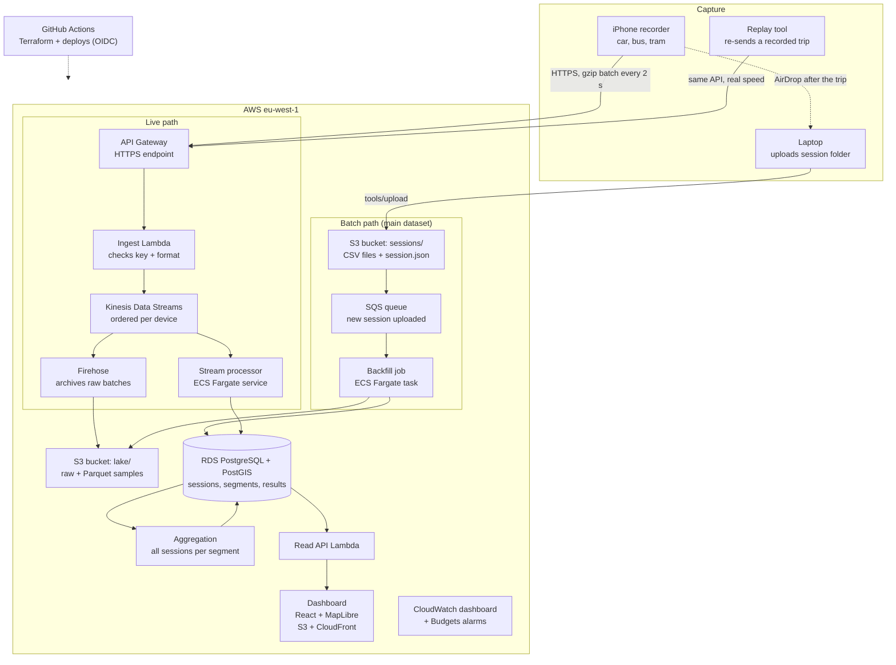

# Infrastructure plan: AWS backend

> **Status:** proposed, 2026-11-20. Researched with parallel research agents and reviewed decision by decision by an independent advisor model (several review rounds). The app side is in [01-initial-plan.md](01-initial-plan.md); research sources are in [03-research-notes.md](03-research-notes.md).
>
> **Who this is for:** anyone on the team, including people who have not used these AWS tools before. Every tool is explained in plain words in §5, together with why we picked it and what we rejected.

---

## 1. The plan in one paragraph

Phones record trips in cars, buses and trams. Each finished trip (a "session") is copied from the phone to a laptop and uploaded to **S3** (AWS file storage). A **processing job** turns the raw sensor files into road-quality and motion-sickness numbers per small piece of road and stores them in a **PostgreSQL database with PostGIS** (maps support). An **aggregation step** combines all sessions, so every trip makes the map better. A **web dashboard** shows the map and charts. The same processing code also runs **live**: the phone can send data every 2 seconds through an **API** into a **Kinesis stream**, and the dashboard updates while driving. A **replay tool** sends a recorded trip through that live path, so we can show "live" in the presentation room without a car. Everything is created by **Terraform** (infrastructure as code) and deployed by **GitHub Actions** (CI/CD).

---

## 2. What changed from the first plan

| Topic | First plan | Now | Why |
|---|---|---|---|
| Cloud | Azure | **AWS**, region `eu-west-1` (Ireland) | Team decision; organizers accept any cloud. Ireland is a large, mature EU region with every service we need, cheaper than Frankfurt. |
| Where the data comes from | One test drive | **Many real trips** in cars, buses, trams, aggregated | More real data makes a better map and an honest story. No simulated cars. |
| How data reaches the cloud | Mainly live upload | **Session files are the main path**, live upload is a capability | The full files are complete and high-resolution; live upload can drop data on a bad network. |
| Demo | Live drive | **Recorded results in the room**, a **video** of the live pipeline, and a **replay** of a real trip through the live path | A presentation room has no moving car and unreliable Wi-Fi. |
| Streaming | Kafka (MSK) considered | **Kinesis** | Same idea as Kafka, much less setup and cost at our volume. See §6. |

---

## 3. Does "collect a lot of real data" change the architecture?

Yes, in five places. The overall shape (capture, transmit, process, store, visualize) stays the same.

1. **The batch path becomes the main path.** Uploaded session folders are the real dataset. The live path stays, but it is no longer the only way in.
2. **A new aggregation layer.** We need to line up many trips on the same roads. That means fixed road segments (§8), a table of "one observation per session per segment", and a step that combines them. This is now core, not a stretch goal.
3. **Raw samples stay out of the database.** One hour of driving is about a million sensor rows. Fifty hours would be about fifty million rows, too much for a small database. So raw samples stay in S3 as files (converted to Parquet, a compact column format), and the database only stores results: segments, events, a light track, and downsampled chart data. This keeps the database small and cheap no matter how much we drive.
4. **Every session carries its context.** Vehicle type, bus line, how the phone was mounted, seated or standing. Without that, a bumpy bus would look like a bumpy road. Normalization between vehicles is in §9.
5. **Data quality rules.** Some sessions will be bad (hand-held phone, phone moved). The pipeline marks them and keeps them out of the aggregated map automatically.

How much data is "a lot"? Expect about **5 to 15 sessions** in the time we have. The story to tell is "the method gets better with every trip", not "big data". Storage is no problem either way: each hour is about 100 to 150 MB (CSV plus audio), so even 50 hours is under 10 GB in S3.

---

## 4. Architecture diagram



---

## 5. Every component: what it is, why we chose it

Read this section if a tool name is unfamiliar. Each entry says what the tool is in plain words, what job it does for us, and what we considered instead.

### Capture side

**iPhone recorder app** (built by our teammate, see [01-initial-plan.md](01-initial-plan.md)). Writes every sensor to CSV files on the phone first, so nothing is lost if the network fails. It can also send small batches live.

**Laptop upload** (`tools/upload`, a few lines wrapping `aws s3 cp --recursive`). After a trip, the session folder is AirDropped to a laptop and uploaded with one command. The script uploads all files first and writes a small `_complete.json` marker **last**. Processing starts only when that marker appears, so it never starts on a half-uploaded folder (the app writes `session.json` at the start of a trip, so it can't be the trigger). *Why not upload straight from the phone?* It would mean building signed-upload logic in the app. A laptop command takes minutes to set up and is just as reliable. The advisor review moved this from "fallback" to "main path".

**Replay tool** (`tools/replay`, a small Python script). Reads a recorded session folder, builds the same 2-second batches the phone would send, and posts them to the real API at real speed (or faster). It is our end-to-end test before every drive, and our backup demo: in the room we can show the map updating live from a real trip. Replays are tagged `source=replay` with a new session ID, and are never counted in the aggregated map, so nothing is counted twice.

### Getting data into AWS

**API Gateway (HTTP API).** A managed HTTPS front door: it gives us a public URL with a TLS certificate, and forwards each request to our code. We don't run a web server. *Rejected:* the older "REST API" flavour (more features we don't need, more expensive) and a load balancer plus container (costs money even when idle).

**AWS Lambda (ingest function).** Lambda runs a small function only when a request arrives; you pay per request, and it costs nothing when idle. The ingest function:
- checks the device key (we store only a hash of each key, and compare in constant time so timing can't leak it);
- decompresses the gzip body and checks its format (with pydantic, a Python validation library);
- puts the batch into Kinesis and answers `200`.

It runs **outside** our private network (VPC) on purpose: it then needs no network setup and can reach Kinesis directly.

*Why no duplicate check here?* An earlier design wrote a "seen" record to DynamoDB first. The advisor found a data-loss bug: if that record was written but the next step failed, the phone's retry would get "duplicate" and delete the batch, and the data would be gone. Now duplicates are removed later in the database (§8), where it is safe.

**Kinesis Data Streams (on-demand).** A stream is an ordered, durable log of messages. Producers append to it; consumers read from it at their own pace. Messages stay in the stream for 24 hours by default, so if the processor crashes or is redeployed, nothing is lost: it continues where it stopped. Messages are split into "shards" by a key; we use the **device ID**, so each phone's batches stay in order, which our filters need. "On-demand" means AWS sizes it automatically.

*Why have a stream at all, with only a few phones?* Honestly, not for volume. We keep it because it:
- **decouples** receiving data from processing it, so the phone always gets a fast answer even if processing is slow or down;
- keeps **order per device**, which matters because the filters carry state from one batch to the next;
- lets **two consumers** read the same data independently: the processor and the raw archive;
- costs about **$1 per day** plus pennies for data.

*Rejected:* Kafka on Amazon MSK, RabbitMQ and others (see §6).

**Kinesis Data Firehose.** A no-code delivery service: it reads from the stream, collects records for a minute or a few MB, and writes them to S3 as files. That gives us a raw archive of everything that arrived live, without writing archiving code, and without one S3 file per request (which would get expensive).

Setup details (advisor-reviewed):
- **Record format.** The ingest Lambda puts each batch into Kinesis as **decompressed JSON followed by a newline**, and Firehose gzips the files. Records that stay gzipped would be glued together with no separator, or compressed twice, and the archive couldn't be read back cleanly.
- **Prefix.** Files go under `lake/raw/dt=!{timestamp:yyyy-MM-dd}/` (arrival date, not recording date), which needs an error-output prefix too. We skip dynamic partitioning, which costs extra.
- **Buffering.** 5 MB or 300 s normally; 60 s when we want to see files appear during a demo.
- **Scope.** Firehose only archives live data. Uploaded sessions already have their own `sessions/` prefix. Like Kinesis, Firehose needs the Paid plan.

### Batch path

**Amazon S3.** AWS's file storage ("buckets" of files). Very cheap, very durable, and the place where all raw data lives. We use two prefixes:
- `sessions/`: uploaded session folders, exactly as recorded;
- `lake/`: the Firehose archive and processed Parquet files.

**Parquet.** A compressed, column-based file format used for analytics. A 100 Hz sensor file shrinks a lot, and pandas reads it fast.

**SQS (Simple Queue Service).** A queue of small "to-do" messages. When a session's `_complete.json` marker lands in S3, S3 puts an event in the queue; the backfill job takes it, processes the session, and deletes the message. If processing fails, the message comes back and is retried. This is the job-queue role RabbitMQ would play, but fully managed and practically free.

**ECS on Fargate.** ECS runs Docker containers; Fargate means AWS provides the machines, so we never manage servers. We use it for two things:
- the **stream processor**: a long-running service that reads Kinesis continuously;
- the **backfill job**: a task started per uploaded session.

Both run the **same Python code** (numpy and scipy for signal processing). *Why not Lambda for processing?* The filters keep state for minutes (motion-sickness dose accumulates over a whole trip), and Lambda functions are short-lived and stateless. A container can keep that state in memory and checkpoint it to the database.

**ECR (Elastic Container Registry).** Where our Docker images are stored so ECS can run them. CI pushes a new image on every merge.

### Storage and results

**RDS for PostgreSQL** (`db.t4g.micro`, single availability zone). RDS is a managed database: AWS runs PostgreSQL for us, including backups and patching. The micro size is enough because only results go in (see §3). It sits in a **private subnet**, unreachable from the internet. *Rejected:* Aurora Serverless (can pause to save money, but waking up is slow in a live demo), Timestream (closed to new customers since June 2025), DynamoDB (no map queries).

**PostGIS.** A PostgreSQL extension for geographic data: it stores points, lines and polygons and answers questions like "which road segments are within 20 m of this GPS point". The map runs on it.

**H3.** Uber's open-source system that covers the Earth with hexagons of fixed sizes. We assign every GPS point to a small hexagon (about 25 m across) so that different trips on the same street land in the same cells and can be compared. It needs no map data import. Snapping to real OpenStreetMap roads was considered and dropped (§19).

### Dashboard

**Read API Lambda.** A second small Lambda behind the same API Gateway. It only reads from the database and returns JSON and GeoJSON (map data) to the dashboard. It runs inside the VPC because the database is private. It logs in to the database with **RDS IAM authentication**: the login token is computed locally from the Lambda's own permissions, so it needs no password and no internet access. That avoids a NAT gateway or paid VPC endpoint just to fetch a secret. The database user it uses can only read.

Setup details (advisor-reviewed):
- Enable `iam_database_authentication_enabled` on the instance.
- Create the database user with `CREATE USER reader; GRANT rds_iam TO reader;` plus `SELECT` grants. Never grant `rds_iam` to the admin user, or its password login stops working.
- The IAM policy allows `rds-db:connect` on `arn:aws:rds-db:<region>:<account>:dbuser:<DbiResourceId>/reader`. This uses the instance's *resource ID* (`db-XXXX`), not its name.
- TLS is required: ship the RDS CA bundle with the Lambda and connect with `sslmode=verify-full`.
- A token is only valid for 15 minutes to *open* a connection, so keep the connection in a global variable and reconnect when it fails.

**React + Vite + MapLibre + uPlot, hosted on S3 + CloudFront.**
- *React + Vite*: a common way to build a web app; Vite is the build tool.
- *MapLibre GL JS*: an open-source map library, with free OpenFreeMap tiles (the background map). We colour road segments by roughness or sickness score.
- *uPlot*: a very fast chart library for long time series.
- *S3 + CloudFront*: the built website is just static files in a bucket; CloudFront is AWS's CDN, which serves them fast over HTTPS.

The API allows browser requests (CORS) only from the dashboard's CloudFront address. The dashboard polls the read API every 2 to 5 seconds when showing live data. *Rejected:* WebSockets (more moving parts for a handful of viewers).

### Running and watching it

**VPC (virtual private cloud).** Our own private network in AWS, split into subnets:
- *private subnets* hold the database, which cannot be reached from the internet;
- *public subnets* hold the Fargate containers, which get a public IP so they can reach AWS services.

Firewall rules ("security groups") allow no incoming traffic to the containers, and allow the database only from our own services. *Why not a NAT gateway* (the usual way to give private machines internet access)? It costs about $1 per day per zone plus data, and we don't need it. Free "gateway endpoints" give private access to S3.

**IAM.** AWS's permission system. Every service gets its own role with only the permissions it needs (for example, the ingest Lambda may only write to one stream).

**SSM Parameter Store and Secrets Manager.**
- *Parameter Store* keeps the hashed device keys and settings.
- *Secrets Manager* keeps two database passwords:
  - the **admin** password, created and rotated by RDS itself (`manage_master_user_password`), used only to run migrations when the processor starts;
  - a separate **writer** user, which the processor uses for all normal work.

  Both are handed to the container through ECS `secrets`; the task's execution role needs `secretsmanager:GetSecretValue`.

  The read Lambda uses IAM login instead (see above).

Nothing secret is ever committed to the repo.

**CloudWatch.** AWS's logs, metrics and alarms. One dashboard, defined in Terraform, shows ingest rate, errors, Kinesis "iterator age" (how far behind the processor is), rows written and data-quality counts.

**AWS Budgets.** Sends an email when spending crosses $20 and $50, so a forgotten resource can't surprise us.

### Building and deploying

**Terraform.** Infrastructure as code: we describe every AWS resource in `.tf` files, and Terraform creates, changes or deletes the real resources to match. `terraform plan` shows what would change; `terraform apply` does it. The current state is stored in an S3 bucket with built-in locking, so two people can't apply at once. We use well-known community modules (`terraform-aws-modules`) for the network, database and containers.

**GitHub Actions.** CI/CD inside GitHub: workflows run on every pull request and every merge. They log in to AWS with **OIDC**: GitHub proves which repo and branch a job comes from, AWS trusts that and hands out short-lived credentials. No AWS keys are stored anywhere.

**Docker Compose (local development).** Runs PostgreSQL with PostGIS on a laptop. The processor can run directly on session CSV files, so most development and testing needs no AWS at all.

---

## 6. Why not Kafka, RabbitMQ and other popular tools

We looked at each seriously. The guiding rule: use a tool when the data or the demo needs it, not to fill the slide.

| Tool | What it would do | Why not (for us, now) |
|---|---|---|
| **Kafka on Amazon MSK Serverless** | Stream, like Kinesis | Only reachable from inside the VPC, so the ingest Lambda would need network setup. Needs IAM token login from Python. About $18 per day just to exist. A new cluster address every time it's recreated. Lots of integration risk for a few phones. |
| **Kafka on MSK Provisioned** | Same | 20 to 30 minutes to create; public access is complicated; small brokers limit new connections. |
| **Self-hosted Kafka or Redpanda on EC2** | Same, cheapest Kafka | We'd have to run, secure and fix a broker ourselves, and the ingest Lambda would still need the VPC. |
| **RabbitMQ (Amazon MQ)** | Job queue | SQS does the same job with nothing to run and is practically free. Running both Kafka and RabbitMQ would be overengineering. |
| **DynamoDB** | Duplicate check | Caused the data-loss bug described in §5; the database handles duplicates safely. |
| **Aurora Serverless v2** | Database that pauses | Slow wake-up in a live demo; the micro RDS instance is cheap and always ready. |
| **Timestream** | Time-series database | Closed to new customers since June 2025. |
| **Managed Flink** | Stream processing engine | Hard to package numpy and scipy; heavy for a few days of work. |
| **EKS (Kubernetes)** | Container platform | Costs money just to exist and takes days to set up; Fargate does what we need. |
| **IoT Core (MQTT with device certificates)** | Device messaging | About a day of certificate setup for one phone; HTTPS plus device keys gives a similar security story. |
| **LocalStack** | Fake AWS on a laptop | Now needs an account token; we don't need it since the processor runs on plain files. |
| **A second CI/CD system** | More pipelines | Adds nothing judges can see; GitHub Actions covers everything. |

If the project ever grows to thousands of vehicles, the design moves to Kafka cleanly: the stream sits behind the ingest API, so phones would not change.

---

## 7. How the data flows

**After a trip (main path).**
1. `tools/upload` copies the session folder to `s3://<bucket>/sessions/<sessionId>/` and writes `_complete.json` last.
2. When the marker arrives, S3 sends a message to SQS, which starts the backfill job.
3. The backfill job reads the CSVs and processes them (§9). It writes Parquet samples to `lake/` and results to the database, then refreshes the aggregates.
   - If the same trip was also streamed live, the uploaded files win: the job deletes that session's live results and writes them again from the complete files, so nothing is counted twice.
4. The dashboard shows the new session and the updated map.

**Live (capability, shown on video and with replay).**
1. The phone (or the replay tool) posts a gzip batch every 2 seconds to the API.
2. The ingest Lambda checks it and puts it into Kinesis, keyed by device.
3. Firehose archives raw batches to S3. The stream processor reads the batches in order, runs the same calculations incrementally, and writes live state and segment observations to the database. It records how far it has read in the same database transaction, so a restart continues exactly where it left off.
4. The dashboard polls the read API and moves the live marker along the map.

---

## 8. Data model (PostgreSQL + PostGIS)

| Table | One row per | Key fields |
|---|---|---|
| `vehicles` | vehicle | type (car/bus/tram), make/model, line |
| `devices` | phone | device ID, hashed key |
| `sessions` | trip | vehicle, device, mount (rigid, handheld, location), rater seat and posture, `source` (`upload`/`live`/`replay`), quality status, `include_in_agg` |
| `ingest_batches` | live batch received | (session_id, batch_seq) **unique**: a repeated batch is ignored with `ON CONFLICT DO NOTHING` |
| `segments` | road piece | H3 cell ID, geometry |
| `segment_observations` | session × segment × pass | speed, raw roughness, MSDV contribution, sample count, quality flags |
| `events` | detected pothole or speed bump | position, time, type, confidence, session |
| `labels` | manual tap or rating | type, value, time (from the app's `labels.csv`) |
| `session_series` | downsampled chart data | about 5 Hz vertical and lateral acceleration, speed, MSDV so far |
| `live_state` | device | last position, speed, current scores (for the live view) |
| `segment_agg` (materialized view) | segment × vehicle type | normalized roughness, pothole confirmation ratio, sickness score, number of sessions |

Raw values are always stored as measured; normalization happens only in the aggregate view, so we can change the method later without reprocessing.

**Road segments.** We use **H3 hexagons** (about 25 m). Two trips on the same street fall in the same cells, which is what aggregation needs, and it requires no map import. Its weakness: it can blur two parallel roads or a junction. Watch for that when picking the drive loop.

---

## 9. Processing and aggregation

**Per session** (the same code runs in batch and live):
1. **Clock alignment.** Convert all timestamps to UTC using the clock anchors (`clock.csv`).
2. **Phone-to-vehicle axes.** Use gravity at rest for "down" and GPS course or the main direction of acceleration for "forward". Everything else depends on this step.
3. **Quality checks.** Measure sample rates and gaps. Mark windows invalid when `phone_moved` was tapped, when gravity drifts in the phone's frame, or when the gyro's turn rate disagrees with GPS. Report what fraction of the session is valid.
4. **Road roughness.** Band-pass vertical acceleration (about 1 to 30 Hz), compute RMS per segment pass, and record speed with it.
5. **Potholes and speed bumps.**
   - A pothole is a sharp jump in high-passed vertical acceleration, counted only above 15 km/h.
   - A speed bump shows a double peak in pitch rate (front axle, then rear axle).
   - Detections are scored against manual taps within ±1.5 s, since people react late, as precision and recall.
6. **Motion sickness.**
   - Vertical acceleration through the ISO 2631-1 Wf filter (f1 0.08, f2 0.63, f4 0.25 with Q 0.86, f5 0.0625 with Q 0.80, f6 0.1 with Q 0.80 Hz), then MSDV = √(∫a_w² dt). Roughly MSDV/3 percent of unadapted people may vomit.
   - The prediction is compared against the passengers' MISC ratings.
   - The filter has a unit test checking its frequency response against reference values.
   - Known limit, to state openly: the ISO metric only covers up-and-down motion, while in cars sideways sway is likely a strong cause of sickness. A sideways metric was considered and dropped (§19).

**Across sessions** (the aggregation step):
- **Roughness is normalized per vehicle.** A bus and a car feel the same road differently. We fit one model across all observations: `log(roughness) = road segment effect + vehicle effect + β·log(speed)`. Segments driven by several vehicles tie the vehicle effects together. If there is too little overlap, the fallback is per-session percentiles.
- **Potholes are crowd-confirmed.** A pothole counts as confirmed when it was detected in at least *k* of *n* passes over that segment, with thresholds set per vehicle type.
- **Sickness is not normalized.** It measures what passengers actually feel, so "the bus is worse than the car on this route" is a finding, not an error. Results are split by seat and by seated or standing.

**Plan the trips for overlap.** Crowd confirmation only works if the same streets are driven several times. Pick one fixed loop that shares streets with a bus or tram line, and drive it several times, including at two different speeds.

---

## 10. Data quality and session rules

- **A rigid mount is required for roughness.** Tape or clamp the phone; run the stillness preflight. Sessions with `mount.rigid = false` or `handheld = true` are excluded from roughness and marked "experimental" for sickness.
- **Buses.** Frequent stops, door cycles, kneeling and idling engines are separated using speed near zero and the activity data.
- **Trams.** Rail joints cause regular, repeating impacts. They are labelled as rail joints so they don't count as potholes.
- **Audio is off on public transport** (other passengers, GDPR).
- **Replays are tagged** and never included in aggregates.
- A **data-quality panel** on the dashboard shows per session: sample rates, gaps, GPS accuracy, valid fraction and rejected batches.

---

## 11. Security

| Concern | Measure |
|---|---|
| Data in transit | HTTPS everywhere (API Gateway, CloudFront); database connections use TLS |
| Who may send data | Per-device keys, stored only as hashes, compared in constant time; strict payload validation |
| Data at rest | S3 and RDS encrypted with KMS keys; S3 buckets block all public access (CloudFront reads the website bucket through an access control) |
| Database exposure | Private subnet only, no public access |
| Permissions | One IAM role per service, least privilege |
| CI/CD credentials | GitHub OIDC with short-lived credentials; no stored AWS keys; deploy role usable only from the protected `prod` environment |
| Secrets in the repo | None; gitleaks scans every push |
| Privacy | Raw audio never uploaded live; audio off on public transport; GPS trimmed near trip start and end on the public dashboard |

---

## 12. Infrastructure as code (Terraform)

```
infra/
  bootstrap/          # run once by hand: state bucket, GitHub OIDC provider, CI roles
  main/               # the whole stack (one cloud environment)
    main.tf  variables.tf  outputs.tf  backend.tf (S3, use_lockfile = true)
  modules/
    network/          # VPC, public/private subnets, S3 gateway endpoint, security groups
    storage/          # S3 buckets (sessions, lake, web), SQS + S3 event
    database/         # RDS PostgreSQL + parameter group, Secrets Manager
    streaming/        # Kinesis stream (on-demand) + Firehose to S3
    compute/          # Lambdas (ingest, read), ECR, ECS cluster, processor service, backfill task
    web/              # CloudFront distribution for the dashboard
    observability/    # CloudWatch dashboard + alarms, AWS Budgets
```

- **One cloud environment plus local**, not dev and prod copies; that halves cost and wiring.
- Terraform owns resource definitions; CI only ships new code and images. Terraform ignores those fields, so plan and deploy don't fight.
- PostGIS and tables are created by SQL migrations (`db/migrations/`) that the processor applies at startup.

---

## 13. CI/CD (GitHub Actions)

| Workflow | Runs when | What it does |
|---|---|---|
| `python-ci.yml` | PR touching `services/**` or `tools/**` | ruff (lint), pytest (including the Wf filter test and a test on a sample session) |
| `terraform-plan.yml` | PR touching `infra/**` | fmt, validate, plan; posts the plan as a PR comment; read-only role |
| `terraform-apply.yml` | merge to `main` touching `infra/**` | apply, after approval in the protected `prod` environment |
| `deploy-services.yml` | merge to `main` touching `services/**` | build images, push to ECR, update the ECS service and the Lambdas |
| `deploy-dashboard.yml` | merge to `main` touching `dashboard/**` | build, upload to S3, refresh CloudFront |
| `security.yml` | every PR | gitleaks (scans for committed secrets) |
| `teardown.yml` | manual | `terraform destroy` after the hackathon |

---

## 14. Cost estimate

Approximate, based on us-east-1 prices (Ireland is a few percent higher). Verify in the AWS Pricing Calculator.

| Item | Approx. per day |
|---|---|
| Kinesis on-demand stream (exists 24/7) | ~$1.00 |
| RDS `db.t4g.micro` + 20 GB storage | ~$0.50 |
| Fargate stream processor (0.25 vCPU, 0.5 GB) | ~$0.30 |
| Public IPv4 address for the processor | ~$0.12 |
| Lambda, API Gateway, SQS, Firehose, S3, CloudFront, CloudWatch at our volume | < $0.50 |
| **Total** | **≈ $2 to $3 per day** |

New AWS accounts get up to $200 in credits. Turning the Kinesis stream and the processor off between demo days roughly halves the cost.

---

## 15. Repository layout

```
decisions/            # this folder: plans and decision log
src/mobile-ios/       # iPhone app (teammate, built on a Mac)
services/
  ingest/             # Lambda: validate, put to Kinesis
  read-api/           # Lambda: dashboard queries
  processor/          # shared Python package + entry points: stream, backfill, aggregate
tools/
  upload/             # upload a session folder to S3, marker file last
  replay/             # re-send a recorded session through the live API
  quick_check/        # sanity check of a session folder (from the initial plan §10)
dashboard/            # React + MapLibre + uPlot
db/migrations/        # SQL: PostGIS, tables, views
infra/                # Terraform (see §12)
.github/workflows/    # see §13
docker-compose.yml    # local PostGIS
```

---

## 16. Build order and what to cut

**Day 0 (setup).**
- Upgrade the AWS account to the Paid plan: Kinesis and Firehose are not available on the Free plan.
- Check the Lambda concurrency quota (new accounts are sometimes capped at 10) and request an increase.
- Create the budget alarms, run `infra/bootstrap`, and set up OIDC.

**Day 1.**
- Processing on the first real session folders, locally. This is where the value is.
- In parallel: Terraform main stack; upload → SQS → backfill → RDS; the first map on the dashboard; CI workflows.

**Day 2.**
- Segments, observations and aggregation.
- Ingest API → Kinesis → processor, plus the replay tool.
- Dashboard layers, CloudWatch dashboard, data-quality panel.

**Day 3.** Tests, README and architecture slide, rehearsal, recording the live video.

**Cut in this order if time runs out:** CloudWatch operations dashboard (keep the Budgets alarms) → live upload during drives (keep upload plus replay).

**Never cut:** real data on the map, Terraform, CI/CD.

---

## 17. Top risks

1. **The AWS account can't use Kinesis or Firehose yet** (Free plan), or Lambda is throttled by a low quota. Fix on day 0.
2. **Bad recordings:** loose mount, clock problems, wrong axes. Do a 10-minute dry run and check it with `quick_check` before the first real drive.
3. **Not enough overlapping trips** for aggregation. Plan a fixed loop and repeat it.
4. **Live parts fail in the room** (Wi-Fi, cold start, quota). The recorded results are the main demo; replay and video are the backup.
5. **Expert questions on the method** (few raters, timing noise). Be open about it, and tune on some sessions and test on others.

---

## 18. Open questions

- Is the AWS account on the Paid plan, and what is its Lambda concurrency quota?
- Which loop will we drive repeatedly, and which bus or tram line overlaps it?
- Who owns which part (processing, infra, dashboard, app)?
- When is the dry run?
- How much GPS trimming do we want on the public dashboard and in the public repo?

---

## 19. Dropped from scope (2026-11-20)

These were in earlier versions of the plan. We removed them because they mainly added polish, not value, for a 3-day build. Each can be added back later without changing the rest of the architecture.

| Dropped | What it would have given | Why it's dropped | If we ever want it back |
|---|---|---|---|
| Athena + Glue Data Catalog | SQL queries directly on raw files in S3 | Nobody would use it in 3 days; pandas on the Parquet files does the same job | Define a Glue table over `lake/` in Terraform; the `dt=` prefixes already fit |
| OpenStreetMap road snapping | Segments that follow real roads, no blurring at junctions or parallel roads | H3 hexagons are good enough for aggregation and need no map import | Import an OSM extract, cut roads into 25 m pieces, add a road ID to `segments` |
| Lateral (sideways) sickness metric | A second, non-standard sickness score based on Donohew & Griffin (2004) | Scientifically interesting, not required. The ISO vertical metric covers the requirement | The lateral acceleration is still stored in `session_series`, so the metric can be computed later from existing data |
| checkov in CI | Automatic checks for Terraform misconfigurations | Extra checks that judges rarely open; gitleaks stays for secrets | Add one step to `security.yml` |
| iOS build check in CI | Unsigned simulator build of the app on a macOS runner | The app is built and tested on the Mac anyway | Add an `ios-build.yml` workflow with a path filter on `src/mobile-ios/**` |
